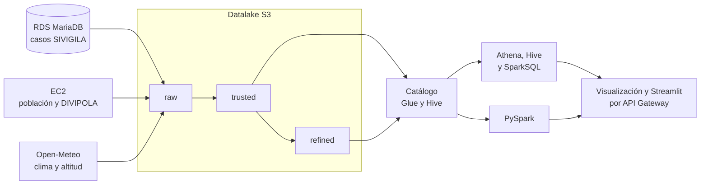

# Proyecto 2 de Big Data: dengue y clima en Colombia

## Integrantes

- Samuel Calderón
- Matías Monsalve
- Camilo Álvarez

## Descripción

Datalake en AWS que cruza los casos de dengue notificados en Colombia entre 2022 y 2024 con la población y el clima de cada municipio. El objetivo es responder seis preguntas de negocio sobre dónde y cuándo se concentra la enfermedad. El caso de estudio completo está en [`punto1-caso-estudio`](punto1-caso-estudio/README.md).

## Arquitectura

La ingesta y las herramientas de cada etapa se confirman en el punto correspondiente.

## Reproducción

Cada carpeta explica cómo reproducir su punto. Se deben seguir en orden, del 1 al 8. Desde el Punto 2 se necesita una cuenta de AWS, y el proyecto se desarrolla en AWS Academy Learner Lab en la región `us-east-1`.

