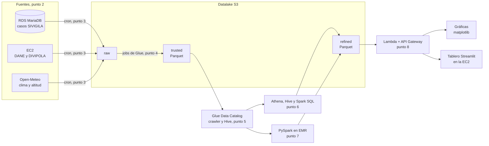

# Proyecto 2 de Big Data: dengue y clima en Colombia

ST0263 Tópicos Especiales en Telemática, Universidad EAFIT.

Datalake en AWS que cruza los casos de dengue notificados en Colombia entre 2022 y 2024 con la población, la altitud y el clima de cada municipio. Responde seis preguntas de negocio sobre dónde y cuándo se concentra la enfermedad, desde la mirada de una secretaría de salud que debe decidir dónde reforzar la prevención.

## Integrantes

- Samuel Calderón, sscalderod1@eafit.edu.co
- Matías Monsalve, mmonsalvr1@eafit.edu.co
- Camilo Álvarez Villegas, calvarezv1@eafit.edu.co

## Informe

El informe con las descripciones, los extractos de código y las evidencias de los ocho puntos está en [`Proyecto2-BigData-Desarrollo.pdf`](Proyecto2-BigData-Desarrollo.pdf).

## Los ocho puntos

Cada carpeta tiene su código, sus evidencias y un `README.md` con las instrucciones para reproducirlo.

| Punto | Carpeta | Qué hace | Herramientas |
|---|---|---|---|
| 1. Caso de estudio | [`punto1-caso-estudio`](punto1-caso-estudio/README.md) | Define las fuentes, las seis preguntas y los valores de control, y perfila los datos | Python, pandas |
| 2. Fuentes de datos | [`punto2-fuentes-datos`](punto2-fuentes-datos/README.md) | Carga SIVIGILA en MariaDB y deja los archivos del DANE y DIVIPOLA en una EC2 | RDS MariaDB, EC2 |
| 3. Ingesta | [`punto3-ingesta`](punto3-ingesta/README.md) | Lleva las tres fuentes a la zona `raw` todos los días, de forma automática | `cron` en la EC2, S3 |
| 4. Preparación | [`punto4-preparacion`](punto4-preparacion/README.md) | Limpia y valida los datos de `raw` y los guarda en `trusted` en Parquet | AWS Glue 5.0, PySpark |
| 5. Catalogación | [`punto5-catalogacion`](punto5-catalogacion/README.md) | Registra las tres zonas como tablas SQL en un solo catálogo | Crawler de Glue, Hive en EMR |
| 6. Consultas SQL | [`punto6-consultas-sql`](punto6-consultas-sql/README.md) | Responde las seis preguntas con un mismo SQL en tres motores y llena `refined` | Athena, Hive, Spark SQL |
| 7. PySpark | [`punto7-pyspark`](punto7-pyspark/README.md) | Repite las preguntas con DataFrames, las compara con Hive y crea tres tablas descriptivas | PySpark en EMR |
| 8. Visualización | [`punto8-visualizacion`](punto8-visualizacion/README.md) | Expone `refined` en una API y la consumen gráficas y un tablero | API Gateway, Lambda, matplotlib, Streamlit |

## Arquitectura



## Respuestas a las preguntas de negocio

| Pregunta | Respuesta corta |
|---|---|
| 1. ¿Qué departamentos y municipios tuvieron la mayor incidencia cada año? | Casanare en 2022, Amazonas en 2023 y Valle del Cauca en 2024, con 1.890,7 casos por 100.000 habitantes |
| 2. ¿En qué semanas se concentra el pico de casos? | No hay una sola temporada. En 2024 el pico del país fue la semana 21, que empezó el 19 de mayo, con 9.396 casos |
| 3. ¿Qué departamentos explican el brote de 2024? | Los casos subieron en 184.272. Valle del Cauca, Santander y Huila explican el 56,9 % del aumento |
| 4. ¿Cómo se relaciona el clima con los casos semanas después? | La temperatura es la variable con más relación, y crece de 0,18 a 2 semanas a 0,24 a 8 semanas. La lluvia y la humedad casi no muestran relación |
| 5. ¿Dónde son mayores la gravedad y la letalidad? | Huila tiene la mayor proporción de dengue grave (2,83 %) y La Guajira la mayor letalidad (0,314 muertes por 100 casos) |
| 6. ¿Cómo cambia la incidencia con la altitud? | Casi no hay dengue por encima de 2.000 m. El brote de 2024 creció más entre 500 y 1.500 m, en los valles interandinos |

Además, el Punto 7 encontró que entre 23 y 29 municipios suman cada año la mitad de los casos del país.

Cada respuesta se calculó con Athena, Hive, Spark SQL y PySpark. Los cuatro motores dan las mismas tablas, y los tres primeros coinciden además con un cálculo independiente en pandas. El detalle está en los README de los puntos [6](punto6-consultas-sql/README.md) y [7](punto7-pyspark/README.md).

## Requisitos para reproducirlo

- AWS Academy Learner Lab iniciado, en la región `us-east-1`. Las credenciales cambian en cada sesión y se copian en `~/.aws/credentials`. El [Punto 2](punto2-fuentes-datos/README.md) explica cómo.
- La llave `labsuser.pem` del lab en `~/.ssh/`.
- AWS CLI v2, `bash`, `curl` y `zip`.
- Python 3.9 o más reciente, con el entorno del proyecto:

```bash
python3 -m venv .venv
```

```bash
source .venv/bin/activate
```

```bash
pip install -r requirements.txt
```

## Orden de ejecución

Todos los scripts se corren desde la raíz del repositorio. Los que crean recursos revisan antes si ya existen, así que se pueden volver a correr. El detalle y los valores esperados de cada paso están en el README de cada punto.

| Punto | Scripts, en orden |
|---|---|
| 1 | `python punto1-caso-estudio/explorar_fuentes.py` |
| 2 | `00_verificar_lab.sh`, `01_crear_red.sh`, `02_crear_rds.sh`, `03_crear_ec2.sh`, `04_cargar_fuentes.sh` |
| 3 | `00_crear_buckets.sh`, `01_instalar_ingesta.sh`, `02_ejecutar_ingesta.sh`, `03_ver_datalake.sh` |
| 4 | `00_crear_jobs.sh`, `01_ejecutar_jobs.sh`, `02_verificar_trusted.sh` |
| 5 | `00_crear_crawler.sh`, `01_crear_emr.sh`, `02_catalogar_hive.sh`, `03_verificar_catalogo.sh` |
| 6 | `00_consultas_athena.sh`, `01_consultas_hive.sh`, `02_consultas_sparksql.sh`, `03_comparar_motores.sh` |
| 7 | `00_analisis_pyspark.sh`, `01_verificar_pyspark.sh` |
| 8 | `00_crear_api.sh`, `01_probar_api.sh`, `02_graficas.sh`, `03_desplegar_app.sh` |

Los puntos 5, 6 y 7 usan el mismo cluster de EMR. Se puede dejar encendido entre ellos y apagarlo al terminar el Punto 7.

## Recursos que se crean en AWS

| Recurso | Nombre | Punto |
|---|---|---|
| RDS MariaDB | `dengue-mariadb` | 2 |
| EC2 | `dengue-fuentes` | 2 |
| Buckets de S3 | `dengue-datalake-<cuenta>` y `dengue-artefactos-<cuenta>` | 3 |
| Jobs y workflow de Glue | `dengue-trusted-*` y `dengue-raw-a-trusted` | 4 |
| Bases del catálogo | `dengue_raw`, `dengue_trusted` y `dengue_refined` | 5 |
| Crawler de Glue | `dengue-crawler-trusted` | 5 |
| Cluster de EMR | `dengue-emr` | 5 a 7 |
| Lambda y API HTTP | `dengue-api` | 8 |

## Apagar los recursos

Para no gastar el crédito del lab al terminar:

```bash
./punto5-catalogacion/terminar_emr.sh
```

```bash
./punto2-fuentes-datos/encender_apagar.sh detener
```

El cluster de EMR también se apaga solo después de una hora sin trabajo. S3, Glue, Athena, Lambda y API Gateway solo cobran cuando se usan.

## Estructura del repositorio

```text
.
├── README.md
├── Proyecto2-BigData-Desarrollo.pdf    informe con las evidencias
├── requirements.txt                    dependencias de Python
├── punto1-caso-estudio/
├── punto2-fuentes-datos/
├── ...
└── punto8-visualizacion/
```

Cada carpeta de punto sigue la misma estructura: scripts numerados en el orden en que se corren, un `comun.sh` con los nombres y funciones compartidas, una carpeta `evidencias/` con los pantallazos y su `README.md`. Los datos descargados quedan en carpetas `datos/`, que no se suben a GitHub.
