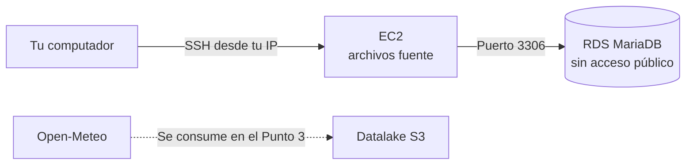

# Punto 2: Fuentes de datos

Este punto monta las tres fuentes que el Punto 3 llevará al datalake.

| Fuente | Servicio | Contenido |
|---|---|---|
| Base de datos | RDS MariaDB 10.11 (`dengue-mariadb`) | Tabla `sivigila.eventos_dengue`, con 61.234 filas |
| Archivos | EC2 (`dengue-fuentes`) | `~/fuentes/poblacion/` (DANE) y `~/fuentes/divipola/` |
| URL | Open-Meteo, en Internet | No requiere montaje |



## Decisiones de diseño

- **RDS sin acceso público:** solo acepta conexiones desde el grupo de seguridad de la EC2. Se carga y se consulta desde allí.
- **SSH restringido:** la EC2 solo acepta SSH desde tu IP pública actual.
- **Fuentes sin limpiar:** la tabla y los archivos conservan los problemas de origen, como los códigos sin cero inicial y la coma decimal, porque se corrigen en el Punto 4.
- **Misma extracción del Punto 1:** se cargan los datos descargados en el Punto 1, para que RDS coincida con `valores_control.json`.
- **Contraseña fuera del repositorio:** se genera en `punto2-fuentes-datos/.env`, que está excluido por `.gitignore`.

## Requisitos

- Haber ejecutado el [Punto 1](../punto1-caso-estudio/README.md), porque este punto usa sus datos.
- Learner Lab iniciado.
- AWS CLI configurado con las credenciales del lab, y la llave SSH del lab.

### Credenciales del lab

Las credenciales cambian en cada sesión del lab.

1. Inicia el lab con **Start Lab** y espera a que el indicador se ponga verde.
2. Abre **AWS Details** y pulsa **Show** en **AWS CLI**.
3. Copia el bloque completo en `~/.aws/credentials`, reemplazando lo que haya.

### Llave SSH

Solo se hace una vez.

1. En **AWS Details**, descarga el archivo **PEM** (`labsuser.pem`).
2. Muévelo a `~/.ssh` y protégelo:

```bash
mv ~/Downloads/labsuser.pem ~/.ssh/labsuser.pem
```

```bash
chmod 400 ~/.ssh/labsuser.pem
```

## Cómo reproducirlo

Ejecuta los scripts desde la raíz del repositorio, en este orden.

**1. Revisar el lab.** No crea nada. Todas las líneas deben decir `OK`.

```bash
./punto2-fuentes-datos/00_verificar_lab.sh
```

**2. Crear la contraseña y los grupos de seguridad.**

```bash
./punto2-fuentes-datos/01_crear_red.sh
```

**3. Crear RDS.** Tarda unos 10 minutos.

```bash
./punto2-fuentes-datos/02_crear_rds.sh
```

**4. Crear la EC2.** Tarda unos 3 minutos.

```bash
./punto2-fuentes-datos/03_crear_ec2.sh
```

**5. Copiar los archivos y cargar RDS.** Al final debe aparecer `OK: RDS coincide con los valores de control.`

```bash
./punto2-fuentes-datos/04_cargar_fuentes.sh
```

Los scripts se pueden repetir: si un recurso ya existe, no lo vuelven a crear.

## Consultar las fuentes

Abre una sesión en la EC2:

```bash
./punto2-fuentes-datos/conectar_ec2.sh
```

Dentro de la EC2, consulta la base de datos y los archivos:

```bash
mariadb --table -e "SELECT ano, SUM(CASE WHEN cod_eve IN (210,220) THEN conteo ELSE 0 END) AS casos, SUM(CASE WHEN cod_eve=580 THEN conteo ELSE 0 END) AS muertes, COUNT(*) AS filas FROM sivigila.eventos_dengue GROUP BY ano WITH ROLLUP"
```

```bash
ls -lh ~/fuentes/poblacion ~/fuentes/divipola
```

Para comprobar la URL, pide unos días de clima de Cali desde cualquier terminal:

```bash
curl -s "https://archive-api.open-meteo.com/v1/archive?latitude=3.41&longitude=-76.52&start_date=2024-01-01&end_date=2024-01-07&daily=temperature_2m_mean,precipitation_sum&timezone=America%2FBogota"
```

## Encender y apagar

Los recursos encendidos consumen créditos del lab. Apágalos cuando termines de trabajar:

```bash
./punto2-fuentes-datos/encender_apagar.sh detener
```

Para volver a trabajar, inicia el lab, renueva las credenciales y enciéndelos:

```bash
./punto2-fuentes-datos/encender_apagar.sh iniciar
```

Para ver cómo están:

```bash
./punto2-fuentes-datos/encender_apagar.sh estado
```

Si cambias de red y SSH deja de responder, tu IP pública cambió. Vuelve a ejecutar `01_crear_red.sh`.

## Comprobar que RDS no es pública

La consola actual de RDS no muestra el campo `Publicly accessible`. Para comprobarlo, consulta la instancia con AWS CLI desde tu computador:

```bash
aws rds describe-db-instances --region us-east-1 --db-instance-identifier dengue-mariadb --query 'DBInstances[0].{Estado:DBInstanceStatus,Publica:PubliclyAccessible,Clase:DBInstanceClass,Version:EngineVersion,GrupoSeguridad:VpcSecurityGroups[0].VpcSecurityGroupId}' --output table
```

`Publica` debe decir `False`.

## Evidencias

- `01-verificar-lab.png`: terminal con la salida de `00_verificar_lab.sh`.
- `02-rds-consola.png`: consola de RDS con `dengue-mariadb` en estado `Available`.
- `03-rds-privada.png`: comprobar que RDS no es `pública` 
- `04-ec2-consola.png`: consola de EC2 con `dengue-fuentes` en estado `Running`.
- `05-grupos-seguridad.png`: reglas de entrada de `dengue-rds-sg`.
- `06-carga-rds.png`: terminal con el resumen de la tabla y el mensaje `OK` de `04_cargar_fuentes.sh`.
- `07-archivos-ec2.png`: terminal con los archivos en la EC2.
- `08-consulta-rds.png`: terminal con la consulta a MariaDB desde la EC2.
