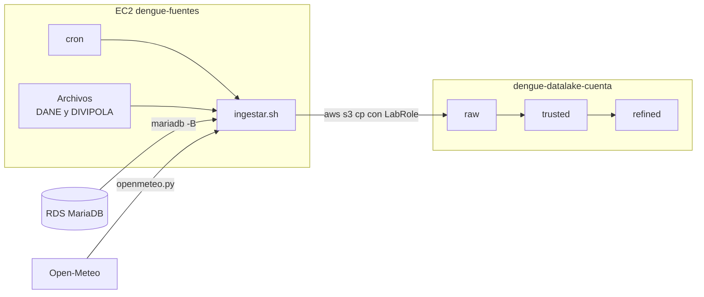

# Punto 3: Ingesta al datalake

Este punto lleva las tres fuentes del Punto 2 a la zona `raw` del datalake en S3, sin modificarlas. La ingesta es automática: un `cron` en la EC2 la ejecuta todos los días y, cada hora, retoma lo que falte de Open-Meteo.



## Datalake

Se crean dos buckets. Los nombres llevan el id de la cuenta, porque en S3 deben ser únicos en todo el mundo.

| Bucket | Uso |
|---|---|
| `dengue-datalake-<cuenta>` | Las tres zonas del datalake |
| `dengue-artefactos-<cuenta>` | Código de los jobs de Glue, métricas y archivos temporales |

| Zona | Contenido | Punto que la llena |
|---|---|---|
| `raw/` | Datos tal como llegan de cada fuente | 3 |
| `trusted/` | Datos limpios y validados, en Parquet | 4 |
| `refined/` | Tablas para responder las preguntas de negocio | 6 y 7 |

### Organización de `raw`

| Ruta | Fuente | Formato |
|---|---|---|
| `raw/sivigila/fecha_ingesta=AAAA-MM-DD/eventos_dengue.tsv` | RDS, tabla `sivigila.eventos_dengue` | TSV con encabezado |
| `raw/poblacion/fecha_ingesta=AAAA-MM-DD/PPED-AreaMun-2018-2042_VP.xlsx` | Archivo del DANE en la EC2 | Excel |
| `raw/divipola/fecha_ingesta=AAAA-MM-DD/divipola.csv` | Archivo DIVIPOLA en la EC2 | CSV con coma decimal |
| `raw/openmeteo/altitud/<cod_mpio>.json` | API de altitud | JSON de la API |
| `raw/openmeteo/clima/<cod_mpio>.json` | API histórica de clima | JSON de la API |

## Decisiones de diseño

- **La EC2 hace la ingesta:** es el único equipo que llega a la RDS privada, tiene los archivos fuente y sale a Internet. Escribe en S3 con el rol del lab (`LabInstanceProfile`), sin llaves guardadas.
- **Raw sin cambios:** la tabla se exporta tal cual, con los códigos sin cero inicial, y los archivos y respuestas de la API se guardan como llegan. La limpieza es del Punto 4.
- **Una partición por día:** RDS y los archivos cambian con el tiempo, así que cada ingesta queda en su propia carpeta `fecha_ingesta=`. El Punto 4 usa la más reciente y las anteriores quedan como historial.
- **Open-Meteo sin partición por día:** el clima de 2021 a 2024 ya no cambia. Cada municipio se guarda una sola vez, y la ingesta solo pide los que faltan.
- **Exportación validada:** antes de subir la tabla, `ingestar.sh` compara las filas exportadas con un `COUNT(*)` en RDS. Si no coinciden, no sube nada.
- **Un candado por paso:** el cron diario y el de cada hora no pueden correr el mismo paso al tiempo.

### Límites de Open-Meteo

La API gratuita permite 600 llamadas por minuto, 5.000 por hora y 10.000 por día. Además, una petición larga cuenta como varias llamadas: Open-Meteo cobra de más las peticiones de más de 2 semanas o de más de 10 variables. Cada municipio pide 1.157 días con 3 variables, así que puede contar como entre 25 y 83 llamadas, según cómo se apliquen las reglas. Por eso, el clima de los 300 municipios puede tardar desde un par de horas hasta varios días.

`openmeteo.py` maneja estos límites así:

- Si se acaba el cupo por minuto, espera 65 segundos y sigue.
- Si se acaba el cupo por hora o por día, sube lo que lleva y termina. El cron de cada hora sigue desde ahí.
- Si la red falla, reintenta hasta 5 veces.

## Requisitos

- Haber terminado el [Punto 2](../punto2-fuentes-datos/README.md), con la EC2 y la RDS encendidas.
- Credenciales del lab vigentes en `~/.aws/credentials`.

Si apagaste los recursos, enciéndelos:

```bash
./punto2-fuentes-datos/encender_apagar.sh iniciar
```

## Cómo reproducirlo

Ejecuta los scripts desde la raíz del repositorio, en este orden.

**1. Crear los buckets y las zonas.**

```bash
./punto3-ingesta/00_crear_buckets.sh
```

**2. Instalar la ingesta en la EC2.** Instala `cron`, copia los scripts y la lista de municipios, comprueba que la EC2 puede escribir en el bucket y programa el `cron`.

```bash
./punto3-ingesta/01_instalar_ingesta.sh
```

**3. Ejecutar la primera ingesta.** RDS y los archivos terminan en segundos. Open-Meteo sigue en segundo plano en la EC2.

```bash
./punto3-ingesta/02_ejecutar_ingesta.sh
```

**4. Revisar el avance.** Solo lee. Cuando todo esté completo, aparece `OK: la zona raw está completa.`

```bash
./punto3-ingesta/03_ver_datalake.sh
```

Los scripts se pueden repetir. Si un bucket ya existe no se vuelve a crear, y si un municipio ya está en S3 no se vuelve a pedir.

### Programación automática

El `cron` de la EC2 queda así, en hora UTC:

| Hora | Comando | Qué hace |
|---|---|---|
| 05:00 todos los días | `ingestar.sh todo` | Exporta RDS, copia los archivos y pide lo que falte de Open-Meteo |
| Minuto 30 de cada hora | `ingestar.sh api` | Sigue con Open-Meteo si quedó pendiente |

El `cron` solo corre mientras la EC2 está encendida. Para que el clima avance, deja el lab y la EC2 encendidos, o vuelve a encenderlos al día siguiente si se acabó el cupo diario.

### Comandos útiles en la EC2

Abre una sesión con `./punto2-fuentes-datos/conectar_ec2.sh` y luego:

```bash
crontab -l
```

```bash
tail -f ~/ingesta/logs/ingesta.log
```

```bash
~/ingesta/ingestar.sh todo
```

## Valores esperados

| Ruta | Esperado |
|---|---|
| `raw/sivigila/` | `eventos_dengue.tsv` con 61.234 filas más el encabezado |
| `raw/poblacion/` | Un `.xlsx` de unos 3,8 MB |
| `raw/divipola/` | Un `.csv` con 1.122 municipios |
| `raw/openmeteo/altitud/` | 1.122 archivos JSON |
| `raw/openmeteo/clima/` | 300 archivos JSON, cada uno con 1.157 días |

## Archivos

| Archivo | Dónde corre | Qué hace |
|---|---|---|
| `comun.sh` | Tu computador | Nombres de los buckets, reusa `punto2-fuentes-datos/comun.sh` |
| `00_crear_buckets.sh` | Tu computador | Crea los buckets, bloquea el acceso público y crea las zonas |
| `01_instalar_ingesta.sh` | Tu computador | Instala la ingesta y el `cron` en la EC2 |
| `02_ejecutar_ingesta.sh` | Tu computador | Ejecuta la ingesta sin esperar al `cron` |
| `03_ver_datalake.sh` | Tu computador | Muestra el contenido de `raw` y el avance de Open-Meteo |
| `ec2/ingestar.sh` | EC2 | Exporta RDS y sube los archivos y las respuestas de la API |
| `ec2/openmeteo.py` | EC2 | Pide altitud y clima, respetando los límites de la API |
| `ec2/crontab.txt` | EC2 | Programación de la ingesta |

## Evidencias

Guardar en `evidencias/`:

- `01-crear-buckets.png`: terminal con la salida de `00_crear_buckets.sh`.
- `02-s3-zonas.png`: consola de S3 con las carpetas `raw/`, `trusted/` y `refined/` del bucket `dengue-datalake-<cuenta>`.
- `03-instalar-ingesta.png`: terminal con la salida de `01_instalar_ingesta.sh`, donde se ven `active`, el mensaje `OK` y el `crontab`.
- `04-ingesta-manual.png`: terminal con la salida de `02_ejecutar_ingesta.sh`.
- `05-raw-consola.png`: consola de S3 dentro de `raw/`, con las carpetas de cada fuente.
- `06-raw-completa.png`: terminal con la salida de `03_ver_datalake.sh` y el mensaje `OK`.
- `07-cron-automatico.png`: terminal en la EC2 con `crontab -l` y las líneas del log que dejó una corrida del `cron`, por ejemplo con `grep -A4 'Inicio' ~/ingesta/logs/ingesta.log | tail -n 15`.
