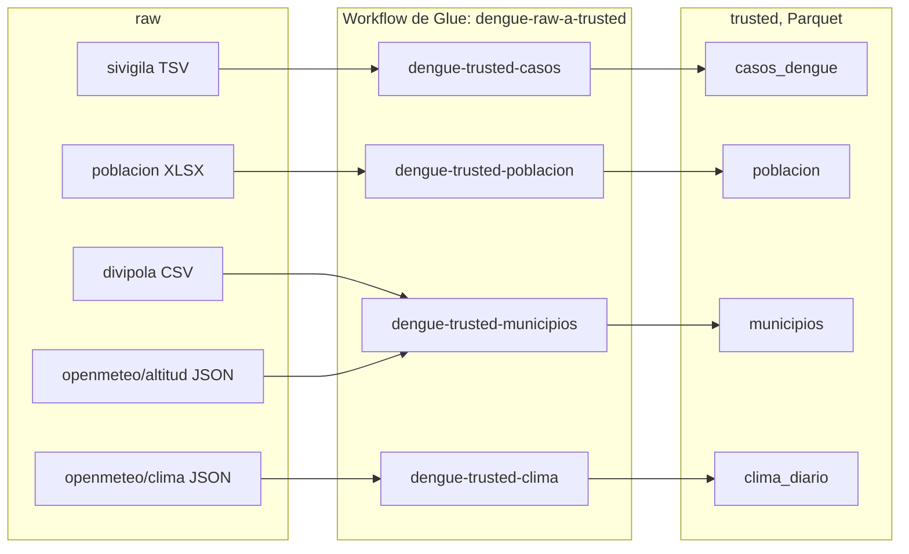

# Punto 4: Preparación de datos, de raw a trusted

Este punto limpia y valida los datos de la zona `raw` y los guarda en la zona `trusted`, en formato Parquet. Lo hacen cuatro jobs de AWS Glue escritos en PySpark, que corren sobre Apache Spark 3.5 (Glue 5.0). Un workflow de Glue los lanza en paralelo.



## Transformaciones

### `casos_dengue`

Lee la ingesta más reciente de `raw/sivigila/`.

| Regla | Resultado esperado |
|---|---|
| Rellenar con ceros los códigos: departamento a 2 dígitos y municipio a 5 | `5001` pasa a `05001` |
| Quitar los casos del exterior (departamento `01`) | 487 filas, con 1.012 casos y 9 muertes |
| Clasificar el evento: 210 y 220 son `caso`, 580 es `muerte` | Columna `tipo_evento` |
| Descartar filas con valores fuera de rango, o con municipio de otro departamento | 0 filas |
| Quitar duplicados por año, semana, municipio y evento | 0 filas |
| Calcular las fechas de inicio y fin de cada semana epidemiológica | La semana 15 de 2024 va del 7 al 13 de abril |

Se guarda particionada por `ano`.

### `poblacion`

Lee el Excel más reciente de `raw/poblacion/`. Spark no lee Excel, así que el job toma el archivo como binario y lo abre con pandas.

| Regla | Resultado esperado |
|---|---|
| Usar la hoja `PobMunicipalxÁrea`, desde la fila 8 | Encabezados del DANE |
| Quitar las notas del final y dejar solo el área `Total` | 28.075 filas |
| Quitar los años con población 0 | 29 filas de Nuevo Belén de Bajirá (`27493`) y Mapiripana (`94663`), antes de existir como municipios |
| Quitar duplicados por municipio y año | 0 filas |

### `municipios`

Une DIVIPOLA con la altitud de Open-Meteo.

| Regla | Resultado esperado |
|---|---|
| Cambiar la coma decimal por punto en latitud y longitud | Coordenadas numéricas |
| Validar que las coordenadas caigan dentro de Colombia | 0 filas fuera |
| Tomar la altitud de cada `raw/openmeteo/altitud/<cod_mpio>.json` | 0 municipios sin altitud |

### `clima_diario`

Convierte cada respuesta de la API en una fila por municipio y día.

| Regla | Resultado esperado |
|---|---|
| Separar las listas paralelas de la API (fecha, temperatura, lluvia, humedad) | 1.157 días por municipio |
| Poner como nulos los valores imposibles | Temperatura entre -10 y 45 °C, lluvia entre 0 y 500 mm, humedad entre 0 y 100 % |
| Quitar los días sin ningún dato y los duplicados | 0 filas |
| Calcular el año y la semana epidemiológica de cada día | Para cruzar con `casos_dengue` |

Se guarda particionada por `ano`, el año calendario.

## Esquema de trusted

| Tabla | Columnas |
|---|---|
| `casos_dengue` | `cod_evento`, `evento`, `tipo_evento`, `semana`, `fecha_inicio_semana`, `fecha_fin_semana`, `cod_dpto`, `departamento`, `cod_mpio`, `municipio`, `conteo`, `fecha_ingesta`, `ano` |
| `poblacion` | `cod_dpto`, `departamento`, `cod_mpio`, `municipio`, `ano`, `poblacion`, `fecha_ingesta` |
| `municipios` | `cod_dpto`, `departamento`, `cod_mpio`, `municipio`, `tipo_municipio`, `latitud`, `longitud`, `altitud_m`, `fecha_ingesta` |
| `clima_diario` | `cod_mpio`, `fecha`, `ano_epi`, `semana_epi`, `temperatura_media_c`, `precipitacion_mm`, `humedad_relativa_pct`, `ano` |

## Decisiones de diseño

- **Glue sobre Spark:** cada job es un script de PySpark. `utilidades.py` detecta si corre en Glue. Si no, los mismos scripts corren con `spark-submit`, en EMR o en un computador.
- **Jobs independientes:** cada tabla tiene su job, así un error en una no detiene las demás, y el workflow las procesa al mismo tiempo.
- **Ingesta más reciente:** los jobs leen solo la última partición `fecha_ingesta=` de cada fuente y guardan esa fecha en la columna `fecha_ingesta`.
- **Nombres de la fuente:** `casos_dengue` conserva los nombres de SIVIGILA, que no siempre son iguales a los oficiales, como `VALLE` en vez de `VALLE DEL CAUCA`. Para cruzar tablas se usan los códigos, no los nombres.
- **Belén de Bajirá:** SIVIGILA usa el código `27086`, que no está en DIVIPOLA. El DANE usa `27493` (Nuevo Belén de Bajirá), con población solo desde 2024. Sus 73 casos quedan en `casos_dengue`, pero no tienen población para calcular la incidencia.
- **Métricas de cada job:** cada job guarda sus conteos en `s3://dengue-artefactos-<cuenta>/metricas/`, y también los imprime en los logs de CloudWatch.
- **Verificación independiente:** `verificar_trusted.py` repite la limpieza con pandas sobre los datos del Punto 1 y compara el resultado con lo que dejó Spark.

## Requisitos

- Haber terminado el [Punto 3](../punto3-ingesta/README.md), con la zona `raw` completa.
- Credenciales del lab vigentes en `~/.aws/credentials`.
- El entorno de Python del Punto 1 con `pyarrow`, para la verificación:

```bash
source .venv/bin/activate
```

```bash
pip install -r requirements.txt
```

La EC2 y la RDS no se necesitan en este punto, así que puedes apagarlas.

## Cómo reproducirlo

Ejecuta los scripts desde la raíz del repositorio, en este orden.

**1. Crear los jobs y el workflow.** Sube el código a `s3://dengue-artefactos-<cuenta>/glue/` y crea los cuatro jobs con el rol `LabRole`.

```bash
./punto4-preparacion/00_crear_jobs.sh
```

**2. Ejecutar el workflow.** Tarda unos 3 a 5 minutos. Al final muestra el estado y las métricas de cada job, y el mensaje `OK: los 4 jobs terminaron bien.`

```bash
./punto4-preparacion/01_ejecutar_jobs.sh
```

**3. Verificar trusted.** Descarga `trusted` a `punto4-preparacion/datos/`, que no se sube a GitHub, y la compara con el Punto 1. Debe terminar en `OK: las 37 revisiones coinciden con el punto 1.`

```bash
./punto4-preparacion/02_verificar_trusted.sh
```

Si cambias un job, vuelve a correr `00_crear_jobs.sh`, que sube el código nuevo y actualiza los jobs.

Si el clima de Open-Meteo todavía no está completo, la verificación muestra `FALLA` en los municipios y filas de `clima_diario`. Espera a que el Punto 3 termine y vuelve a ejecutar el workflow.

### Correr un job sin Glue

Con PySpark 3.5 instalado, cualquier job corre con `spark-submit`. Por ejemplo, con una copia local de `raw`:

```bash
spark-submit --py-files punto4-preparacion/jobs/utilidades.py punto4-preparacion/jobs/trusted_casos.py --RAW datos/raw --TRUSTED datos/trusted --METRICAS datos/metricas
```

En EMR se usa el mismo comando con rutas `s3://`.

## Valores esperados

| Tabla | Filas | Otros valores |
|---|---:|---|
| `casos_dengue` | 60.747 | 506.794 casos, 478 muertes y 994 municipios con casos |
| `poblacion` | 28.046 | 1.123 municipios, de 2018 a 2042. En 2024, 52.613.753 habitantes |
| `municipios` | 1.122 | 0 sin altitud |
| `clima_diario` | 347.100 | 300 municipios, del 2021-11-01 al 2024-12-31 |

Casos y muertes por año en `casos_dengue`:

| Año | Casos | Muertes |
|---|---:|---:|
| 2022 | 66.758 | 82 |
| 2023 | 127.882 | 117 |
| 2024 | 312.154 | 279 |

Frente al Punto 1 faltan 1.012 casos y 9 muertes, que son los del exterior.

## Archivos

| Archivo | Qué hace |
|---|---|
| `comun.sh` | Nombres de los jobs y configuración de Glue |
| `00_crear_jobs.sh` | Sube el código y crea o actualiza los jobs, el workflow y su disparador |
| `01_ejecutar_jobs.sh` | Corre el workflow, espera a que termine y muestra las métricas |
| `02_verificar_trusted.sh` | Descarga `trusted` y ejecuta `verificar_trusted.py` |
| `verificar_trusted.py` | Compara `trusted` con los datos del Punto 1 |
| `jobs/utilidades.py` | Funciones comunes: parámetros, ingesta más reciente, semanas epidemiológicas y escritura |
| `jobs/trusted_casos.py` | Job de `casos_dengue` |
| `jobs/trusted_poblacion.py` | Job de `poblacion` |
| `jobs/trusted_municipios.py` | Job de `municipios` |
| `jobs/trusted_clima.py` | Job de `clima_diario` |

## Evidencias

Guardar en `evidencias/`:

- `01-crear-jobs.png`: terminal con la salida de `00_crear_jobs.sh`.
- `02-jobs-consola.png`: consola de Glue, en **ETL jobs**, con los cuatro jobs `dengue-trusted-*`.
- `03-codigo-job.png`: consola de Glue con el script de `dengue-trusted-casos` abierto.
- `04-ejecutar-jobs.png`: terminal con la salida de `01_ejecutar_jobs.sh` y el mensaje `OK`.
- `05-workflow-consola.png`: consola de Glue, en **Workflows**, con el grafo de la última corrida de `dengue-raw-a-trusted` completada.
- `06-trusted-s3.png`: consola de S3 dentro de `trusted/`, con las cuatro tablas.
- `07-verificar-trusted.png`: terminal con la salida de `02_verificar_trusted.sh` y el mensaje `OK`.
