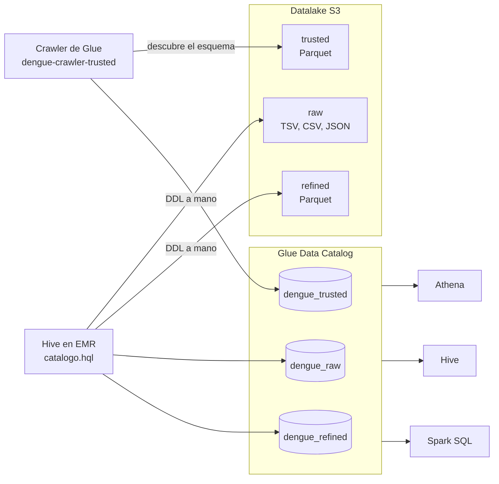

# Punto 5: Catalogación de tablas

Este punto registra las tres zonas del datalake como tablas SQL en el **AWS Glue Data Catalog**. Se usan dos herramientas:

- **Un crawler de Glue** descubre solo el esquema de los Parquet de `trusted`.
- **Hive en EMR** define a mano las tablas de `raw`, que son texto y JSON, y crea las tablas vacías de `refined`, que el Punto 6 llena.
 
El cluster de EMR usa el catálogo de Glue como metastore de Hive. Así, las tablas que crea cualquiera de las dos herramientas quedan en un solo catálogo. Athena, Hive y Spark SQL las leen sin copiar nada, y no se pierden al apagar el cluster.



## Bases del catálogo

| Base | Zona | La cataloga | Tablas |
|---|---|---|---|
| `dengue_raw` | `raw/` | Hive | `sivigila`, `divipola`, `openmeteo_altitud`, `openmeteo_clima` |
| `dengue_trusted` | `trusted/` | Crawler de Glue | `casos_dengue`, `poblacion`, `municipios`, `clima_diario` |
| `dengue_refined` | `refined/` | Hive | `incidencia_departamento`, `incidencia_municipio`, `estacionalidad_departamento`, `brote_2024_departamento`, `clima_rezago`, `gravedad_departamento`, `incidencia_altitud` |

### `dengue_raw`, definida con Hive

Los archivos de `raw` no traen un esquema que un crawler pueda leer bien. El TSV y el CSV necesitan saltar el encabezado, DIVIPOLA trae comillas y comas decimales, y los JSON de Open-Meteo son listas dentro de un objeto. Por eso cada tabla se define en [`hive/catalogo.hql`](hive/catalogo.hql) con su SerDe.

| Tabla | Formato | SerDe | Partición |
|---|---|---|---|
| `sivigila` | TSV con encabezado | `LazySimpleSerDe`, campos separados por tabulador | `fecha_ingesta` |
| `divipola` | CSV con comillas | `OpenCSVSerde` | `fecha_ingesta` |
| `openmeteo_altitud` | Un JSON por municipio | `JsonSerDe` de HCatalog | |
| `openmeteo_clima` | Un JSON por municipio, con listas diarias | `JsonSerDe` de HCatalog | |

Las particiones `fecha_ingesta=` se registran con `MSCK REPAIR TABLE`. El Excel de población no se cataloga en `raw` porque Hive no lee `.xlsx`. Su versión limpia es `dengue_trusted.poblacion`.

### `dengue_trusted`, descubierta por el crawler

El crawler `dengue-crawler-trusted` tiene una ruta por tabla. Así cada carpeta queda como una tabla con su nombre. Lee el esquema de los Parquet y registra las particiones `ano=`. Si se vuelve a correr después de un nuevo procesamiento, actualiza las tablas en vez de duplicarlas.

El crawler registra la partición `ano` como `string`, porque la toma del nombre de la carpeta. Las consultas del Punto 6 la convierten con `CAST(ano AS INT)`.

### `dengue_refined`, creada con Hive

Son las tablas de respuestas a las preguntas de negocio, en Parquet. En este punto solo se define su esquema, con un comentario por tabla y por columna. El Punto 6 las llena con `INSERT OVERWRITE` desde Hive.

## Decisiones de diseño

- **Un solo catálogo:** EMR se configura con `AWSGlueDataCatalogHiveClientFactory` en `hive-site` y `spark-hive-site` ([`emr/configuracion.json`](emr/configuracion.json)). Sin esto, Hive guardaría sus tablas en un metastore local que se borra al apagar el cluster.
- **Crawler para Parquet y DDL para texto:** el crawler acierta con Parquet porque el esquema viene dentro del archivo. Con texto y JSON es mejor escribir el esquema a mano y elegir el SerDe.
- **SerDe compatible con Athena:** se usa el `JsonSerDe` de HCatalog (`org.apache.hive.hcatalog.data.JsonSerDe`) porque Athena también lo entiende. El script del paso busca el jar en el cluster y lo carga con `ADD JAR`.
- **Tablas externas:** todas son `EXTERNAL`. Si se borra una tabla, los datos siguen en S3.
- **Cluster pequeño y con apagado automático:** 1 nodo maestro y 2 núcleos `m5.xlarge` con EMR 7.5.0, que trae Hive 3.1 y Spark 3.5.
- **Pasos de EMR:** Hive corre como un paso del cluster, no por SSH. Así queda registrado en la consola de EMR y su salida queda guardada en `s3://dengue-artefactos-<cuenta>/emr-logs/`.

## Requisitos

- [Punto 4](../punto4-preparacion/README.md), con `trusted` completa.
- Credenciales del lab vigentes en `~/.aws/credentials`.
- Para la sesión interactiva opcional, la llave `labsuser.pem` en `~/.ssh/`, la misma del Punto 2.

La EC2 y la RDS no se necesitan.

## Cómo reproducirlo

**1. Crear y correr el crawler.** Crea la base `dengue_trusted` y el crawler, lo corre y muestra las tablas y el esquema que encontró. Termina con `OK: el crawler catalogó las 4 tablas de trusted.`

```bash
./punto5-catalogacion/00_crear_crawler.sh
```

**2. Crear el cluster de EMR.** Tarda unos 10 minutos. Si el lab no permite `m5.xlarge`, se puede cambiar el tipo, por ejemplo con `EMR_TIPO=m4.xlarge`.

```bash
./punto5-catalogacion/01_crear_emr.sh
```

**3. Catalogar con Hive.** Sube [`hive/catalogo.hql`](hive/catalogo.hql), lo corre como paso de EMR y muestra la salida de Hive. EMR tarda unos 5 minutos en publicar esa salida.

```bash
./punto5-catalogacion/02_catalogar_hive.sh
```

**4. Verificar con Athena.** Lista las bases y cuenta las filas de cada tabla con Athena. Debe terminar en `OK: las tres zonas están catalogadas y Athena las puede leer.`

```bash
./punto5-catalogacion/03_verificar_catalogo.sh
```

Dejar el cluster encendido para el [Punto 6](../punto6-consultas-sql/README.md).

### Usar Hive a mano

`conectar_emr.sh` abre el puerto 22 del nodo maestro solo para tu IP y entra por SSH. Dentro del cluster:

```bash
hive -e "SHOW DATABASES; SHOW TABLES IN dengue_raw; DESCRIBE FORMATTED dengue_raw.sivigila;"
```

```bash
hive -e "SELECT fecha_ingesta, count(*) FROM dengue_raw.sivigila GROUP BY fecha_ingesta;"
```

Sal con `exit`.

```bash
./punto5-catalogacion/conectar_emr.sh
```

### Apagar el cluster

despues dell Punto 6:

```bash
./punto5-catalogacion/terminar_emr.sh
```

El catálogo y los datos quedan en Glue y S3. Para volver a usar Hive o Spark, se crea otro cluster con `01_crear_emr.sh`.

## Valores esperados

| Tabla | Filas |
|---|---:|
| `dengue_trusted.casos_dengue` | 60.747 |
| `dengue_trusted.poblacion` | 28.046 |
| `dengue_trusted.municipios` | 1.122 |
| `dengue_trusted.clima_diario` | 347.100 |
| `dengue_raw.sivigila`, ingesta más reciente | 61.234 |
| `dengue_raw.divipola`, ingesta más reciente | 1.122 |
| `dengue_raw.openmeteo_altitud` | 1.122 |
| `dengue_raw.openmeteo_clima` | 300, con 347.100 valores diarios |
| `dengue_refined` | 7 tablas, vacías hasta el Punto 6 |

`raw` guarda una partición por cada día que corrió la ingesta automática del Punto 3. Por eso las tablas de `raw` se cuentan en su ingesta más reciente.

## Archivos

| Archivo | Qué hace |
|---|---|
| `comun.sh` | Nombres de las bases, el crawler y el cluster, y funciones para pasos de EMR y consultas de Athena |
| `00_crear_crawler.sh` | Crea la base `dengue_trusted` y el crawler, y lo corre |
| `01_crear_emr.sh` | Crea el cluster de EMR con Hive y Spark sobre el catálogo de Glue |
| `02_catalogar_hive.sh` | Corre `hive/catalogo.hql` como paso de EMR |
| `03_verificar_catalogo.sh` | Revisa el catálogo y cuenta las filas con Athena |
| `conectar_emr.sh` | Abre una sesión SSH en el nodo maestro |
| `terminar_emr.sh` | Apaga el cluster |
| `hive/catalogo.hql` | DDL de `dengue_raw` y `dengue_refined` |
| `emr/configuracion.json` | Usa el catálogo de Glue como metastore de Hive y Spark |

## Evidencias


- `01-crear-crawler.png`: terminal con la salida de `00_crear_crawler.sh` y el mensaje `OK`.
- `02-crawler-consola.png`: consola de Glue, en **Crawlers**, con `dengue-crawler-trusted` y su última corrida en *Succeeded*.
- `03-tabla-trusted-consola.png`: consola de Glue, en **Data Catalog > Tables**, con el esquema de `casos_dengue` y la partición `ano`.
- `04-crear-emr.png`: terminal con la salida de `01_crear_emr.sh`.
- `05-emr-consola.png`: consola de EMR con `dengue-emr` en *Waiting* y sus aplicaciones.
- `06-catalogar-hive.png`: terminal con la salida de Hive de `02_catalogar_hive.sh`.
- `07-hive-interactivo.png`: sesión de `conectar_emr.sh` con `SHOW DATABASES` y `SHOW TABLES IN dengue_raw`.
- `08-verificar-catalogo.png`: terminal con la salida de `03_verificar_catalogo.sh` y el mensaje `OK`.
- `09-athena-catalogo.png`: consola de Athena con la base `dengue_raw` elegida, sus tablas a la izquierda y el resultado de `SELECT * FROM openmeteo_altitud LIMIT 5`.
