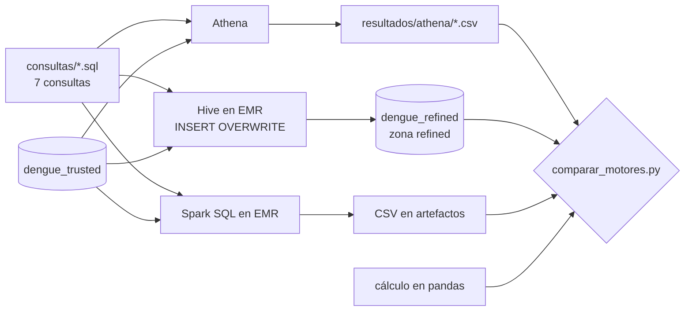

# Punto 6: Consultas SQL con Athena, Hive y Spark SQL
 
Este punto responde las seis preguntas de negocio del [Punto 1](../punto1-caso-estudio/README.md) con SQL sobre las tablas catalogadas en el [Punto 5](../punto5-catalogacion/README.md). Cada pregunta se escribe una sola vez, en [`consultas/`](consultas/), y corre igual en tres motores:

- **Athena:** consulta `dengue_trusted` sin servidores y guarda cada respuesta en [`resultados/athena/`](resultados/athena/).
- **Hive en EMR:** corre las mismas consultas y guarda las respuestas en la zona `refined`, en las tablas de `dengue_refined`.
- **Spark SQL en EMR:** corre las mismas consultas y deja las respuestas en CSV, para compararlas.

Al final, un script compara las respuestas de los tres motores con un cálculo propio en pandas.



## Preguntas y consultas

| Pregunta | Consulta | Tabla en `refined` |
|---|---|---|
| 1. ¿Qué departamentos y municipios tuvieron la mayor incidencia cada año? | [`p1_incidencia_departamento.sql`](consultas/p1_incidencia_departamento.sql), [`p1_incidencia_municipio.sql`](consultas/p1_incidencia_municipio.sql) | `incidencia_departamento`, `incidencia_municipio` |
| 2. ¿En qué semanas epidemiológicas se concentra el pico de casos en cada departamento? | [`p2_estacionalidad_departamento.sql`](consultas/p2_estacionalidad_departamento.sql) | `estacionalidad_departamento` |
| 3. ¿Qué departamentos explican el aumento de casos de 2024 frente a 2023? | [`p3_brote_2024_departamento.sql`](consultas/p3_brote_2024_departamento.sql) | `brote_2024_departamento` |
| 4. ¿Cómo se relacionan la lluvia y la temperatura con los casos 2, 4, 6 y 8 semanas después? | [`p4_clima_rezago.sql`](consultas/p4_clima_rezago.sql) | `clima_rezago` |
| 5. ¿Qué departamentos tienen la mayor proporción de gravedad y la mayor letalidad? | [`p5_gravedad_departamento.sql`](consultas/p5_gravedad_departamento.sql) | `gravedad_departamento` |
| 6. ¿Cómo cambia la incidencia entre rangos de altitud del municipio? | [`p6_incidencia_altitud.sql`](consultas/p6_incidencia_altitud.sql) | `incidencia_altitud` |

Las definiciones de casos, incidencia, gravedad y letalidad son las del Punto 1. La incidencia usa como numerador los casos de los municipios que tienen población en el DANE, igual que el Punto 1.

## Respuestas

Las cifras son las que deben dar los tres motores. Las tablas completas quedan en `resultados/athena/` y en `dengue_refined`.

### 1. Incidencia

Departamentos con mayor incidencia, en casos por 100.000 habitantes:

| Puesto | 2022 | 2023 | 2024 |
|---:|---|---|---|
| 1 | Casanare, 857,7 | Amazonas, 1.212,0 | Valle del Cauca, 1.890,7 |
| 2 | Guaviare, 781,2 | Meta, 1.117,8 | Tolima, 1.830,7 |
| 3 | Amazonas, 579,3 | Tolima, 903,7 | Huila, 1.710,0 |
| 4 | Arauca, 516,7 | Guaviare, 901,4 | Santander, 1.516,4 |
| 5 | Sucre, 486,7 | Vaupés, 684,6 | Quindío, 1.289,0 |

El Valle del Cauca en 2024 da 1.890,7, la misma cifra que el Punto 1.

En los municipios, los primeros puestos son municipios pequeños, donde pocos casos suben mucho la tasa. En 2024 los primeros fueron Vijes, Valle del Cauca, con 6.910,0 y 960 casos; San Pablo de Borbur, Boyacá, con 6.615,5; y La Unión, Valle del Cauca, con 6.041,4. Entre los municipios de más de 100.000 habitantes, los primeros de 2024 fueron Guadalajara de Buga (3.763,5), Yumbo (3.713,9) y Jamundí (3.074,1), los tres del Valle del Cauca.

### 2. Estacionalidad

No hay una sola temporada. En 2024, el año del brote, el pico llegó en la primera mitad del año en casi todos los departamentos con muchos casos:

| Departamento | Semana pico 2024 | Inicio | Casos en la semana |
|---|---:|---|---:|
| Valle del Cauca | 14 | 2024-03-31 | 3.114 |
| Santander | 24 | 2024-06-09 | 1.365 |
| Tolima | 20 | 2024-05-12 | 765 |
| Huila | 10 | 2024-03-03 | 790 |
| Antioquia | 27 | 2024-06-30 | 605 |

En 2023, en cambio, el pico de Valle del Cauca, Tolima y Santander fue la semana 50, en diciembre, cuando empezaba el brote. En el país, la semana con más casos fue la 49 en 2022, la 50 en 2023 y la 21 en 2024.

En los departamentos con más casos, la semana pico tiene entre el 3 % y el 6 % de los casos del año. Es decir, la transmisión dura varios meses y no se concentra en pocas semanas.

### 3. Brote de 2024

Los casos subieron en 184.272. Tres departamentos explican el 56,9 % del aumento, y cinco el 70,6 %:

| Departamento | Casos 2023 | Casos 2024 | Aumento | Parte del aumento | Cambio |
|---|---:|---:|---:|---:|---:|
| Valle del Cauca | 24.203 | 88.740 | 64.537 | 35,0 % | +266,7 % |
| Santander | 11.428 | 36.101 | 24.673 | 13,4 % | +215,9 % |
| Huila | 4.713 | 20.430 | 15.717 | 8,5 % | +333,5 % |
| Tolima | 12.413 | 25.272 | 12.859 | 7,0 % | +103,6 % |
| Antioquia | 5.322 | 17.684 | 12.362 | 6,7 % | +232,3 % |

Siete departamentos tuvieron menos casos en 2024 que en 2023. Las mayores bajas fueron las de Meta, Cesar, Magdalena y La Guajira.

### 4. Clima

Para cada uno de los 300 municipios con clima se mide la correlación entre la incidencia semanal y el clima de 2, 4, 6 y 8 semanas antes. Luego se promedian. Medirla dentro de cada municipio quita las diferencias entre lugares, por ejemplo que los municipios cálidos tienen más casos, y deja solo la relación en el tiempo.

| Rezago | Correlación con la lluvia | Correlación con la temperatura | Correlación con la humedad | Municipios con relación positiva a la temperatura |
|---:|---:|---:|---:|---:|
| 2 semanas | 0,060 | 0,180 | 0,022 | 72,3 % |
| 4 semanas | 0,058 | 0,195 | 0,018 | 74,0 % |
| 6 semanas | 0,048 | 0,216 | 0,002 | 75,3 % |
| 8 semanas | 0,030 | 0,243 | -0,023 | 77,7 % |

La temperatura es la variable con más relación. Las semanas más calientes anteceden a más casos, y la relación crece de 2 a 8 semanas de rezago. Coincide con el ciclo del mosquito y del virus, que se acelera con el calor. La lluvia y la humedad casi no muestran relación a esta escala. La correlación es débil y mide asociación, no causalidad.

### 5. Gravedad y letalidad

En el país, de 2022 a 2024, el 1,19 % de los casos fue dengue grave y la letalidad fue de 0,094 muertes por cada 100 casos.

| Mayor gravedad | Dengue grave por 100 casos | Mayor letalidad | Muertes por 100 casos |
|---|---:|---|---:|
| Huila | 2,83 | La Guajira | 0,314 |
| Cesar | 2,50 | Chocó | 0,223 |
| Atlántico | 2,16 | Cesar | 0,222 |
| La Guajira | 2,09 | Putumayo | 0,209 |
| Norte de Santander | 1,77 | Guainía | 0,195 |

La Guajira y Cesar están arriba en las dos listas. El Valle del Cauca, con más casos que ningún otro, tiene una letalidad baja, de 0,058.

### 6. Altitud

| Altitud del municipio | Incidencia 2022 | Incidencia 2023 | Incidencia 2024 |
|---|---:|---:|---:|
| Menos de 500 m | 291,0 | 373,5 | 488,0 |
| 500 a 999 m | 113,6 | 557,3 | 1.792,1 |
| 1.000 a 1.499 m | 30,5 | 215,8 | 940,1 |
| 1.500 a 1.999 m | 7,0 | 41,2 | 598,2 |
| 2.000 m o más | 0,4 | 1,9 | 14,2 |

Por encima de 2.000 m casi no hay dengue. El brote de 2024 se concentró entre 500 y 1.500 m, en los valles interandinos. En la franja de 500 a 999 m la incidencia se multiplicó por 16 frente a 2022. En la de 1.500 a 1.999 m pasó de 7,0 a 598,2, mientras que en las tierras bajas, de menos de 500 m, solo creció 1,7 veces. Esto sugiere que el dengue llegó con más fuerza a municipios más altos que antes casi no tenían casos.

## Cómo corre cada motor

Las siete consultas usan un SQL que entienden los tres motores. Cada script les pone lo que su motor necesita:

| Motor | Qué le agrega el script | Dónde queda la respuesta |
|---|---|---|
| Athena | Nada, corre el archivo tal cual sobre `dengue_trusted` | `resultados/athena/<tabla>.csv` y `s3://dengue-artefactos-<cuenta>/athena/` |
| Hive | `INSERT OVERWRITE TABLE dengue_refined.<tabla>` antes de cada consulta | `s3://dengue-datalake-<cuenta>/refined/<tabla>/`, en Parquet |
| Spark SQL | `CREATE TEMPORARY VIEW` y `INSERT OVERWRITE DIRECTORY ... USING csv` | `s3://dengue-artefactos-<cuenta>/resultados/sparksql/<tabla>/` |

Hive y Spark SQL corren como pasos del cluster de EMR del Punto 5, con los scripts que arman `generar_hive` y `generar_sparksql` en `comun.sh`.

## Decisiones de diseño

- **Un solo SQL para tres motores:** Athena usa Trino y su dialecto difiere del de Hive y Spark. Para que el mismo archivo funcione en los tres, las consultas siguen estas reglas: subconsultas con alias en vez de `WITH`, `CAST` a `DOUBLE` antes de dividir porque Trino divide enteros sin decimales, funciones de ventana sin expresiones dentro y `ORDER BY` solo con columnas del resultado.
- **Refined la escribe Hive:** la zona `refined` es la fuente para los puntos 7 y 8. Hive la escribe sobre tablas que ya tienen esquema y comentarios en el catálogo. Athena las puede leer de inmediato.
- **Spark SQL como verificación:** Spark escribe en el bucket de artefactos para no pisar `refined`. Sus respuestas solo se usan para comparar.
- **Clima medido dentro de cada municipio:** si se juntan todos los municipios, la correlación sale casi en cero (0,03 con la lluvia y -0,02 con la temperatura), porque la diferencia entre lugares tapa la relación en el tiempo. Por eso la consulta calcula una correlación por municipio y después las promedia.
- **Puestos con `rank()`:** si dos filas empatan, reciben el mismo puesto en los tres motores. Con `row_number()` el desempate podría cambiar de un motor a otro.
- **Verificación independiente:** `comparar_motores.py` repite las siete respuestas en pandas a partir de `trusted` y compara cada columna, con la tolerancia del redondeo del SQL.

## Requisitos

- Punto 5, con las tres bases en el catálogo y el cluster `dengue-emr` en *Waiting*.
- Credenciales del lab vigentes en `~/.aws/credentials`.
- El entorno de Python del Punto 1 con `pyarrow`, para la comparación:

```bash
source .venv/bin/activate
```

## Cómo reproducirlo

**1. Consultas en Athena.** Corre las siete consultas, muestra las primeras filas y guarda cada resultado en `resultados/athena/`. Tarda alrededor de un minuto.

```bash
./punto6-consultas-sql/00_consultas_athena.sh
```

**2. Consultas en Hive.** Llena las siete tablas de `refined`. El paso tarda unos 3 minutos, y EMR publica su salida unos 5 minutos después.

```bash
./punto6-consultas-sql/01_consultas_hive.sh
```

**3. Consultas en Spark SQL.** Corre las mismas consultas en Spark y deja las respuestas en CSV.

```bash
./punto6-consultas-sql/02_consultas_sparksql.sh
```

**4. Comparar los motores.** Cuenta con Athena las filas de `refined`, descarga las respuestas y las compara. Debe terminar en `OK: Athena, Hive y Spark SQL dan las mismas 7 tablas que el cálculo en pandas.`

```bash
./punto6-consultas-sql/03_comparar_motores.sh
```

**5. Apagar el cluster.**

```bash
./punto5-catalogacion/terminar_emr.sh
```

Si cambias una consulta, vuelve a correr los cuatro scripts. Cualquier consulta también se puede pegar en el editor de Athena, eligiendo la base `dengue_trusted`.

## Valores esperados

| Tabla | Filas |
|---|---:|
| `incidencia_departamento` | 99, 33 departamentos por 3 años |
| `incidencia_municipio` | 3.364 |
| `estacionalidad_departamento` | 96, 32 departamentos con casos por 3 años |
| `brote_2024_departamento` | 32 |
| `clima_rezago` | 4, un rezago por fila |
| `gravedad_departamento` | 32 |
| `incidencia_altitud` | 15, 5 rangos por 3 años |

Bogotá no tiene casos de dengue que ocurrieran en su territorio, por eso hay 32 departamentos con casos y 33 con población.

## Archivos

| Archivo | Qué hace |
|---|---|
| `comun.sh` | Rutas y funciones que arman los scripts de Hive y Spark SQL |
| `consultas/*.sql` | Una consulta por tabla de respuesta |
| `00_consultas_athena.sh` | Corre las consultas en Athena y guarda los CSV |
| `01_consultas_hive.sh` | Corre las consultas en Hive y llena `refined` |
| `02_consultas_sparksql.sh` | Corre las consultas en Spark SQL |
| `03_comparar_motores.sh` | Lee `refined` con Athena, descarga las respuestas y ejecuta la comparación |
| `comparar_motores.py` | Calcula las respuestas en pandas y las compara con los tres motores |
| `resultados/athena/` | Respuestas de Athena en CSV |

## Evidencias

- `01-consultas-athena.png`: terminal con la salida de `00_consultas_athena.sh`, por ejemplo la pregunta 3 y el mensaje `OK`.
- `02-athena-consola.png`: consola de Athena con `p1_incidencia_departamento.sql` pegada en el editor, la base `dengue_trusted` elegida y el resultado.
- `03a-consultas-hive.png`: terminal con el paso de `01_consultas_hive.sh` y las carpetas de la zona refined.
- `03b-consultas-hive.png`: salida de Hive del paso, con las filas de muestra de cada tabla de `dengue_refined`.
- `04-consultas-sparksql.png`: terminal con la salida de Spark SQL de `02_consultas_sparksql.sh`.
- `05-pasos-emr-consola.png`: consola de EMR, en la pestaña **Steps** de `dengue-emr`, con los pasos de Hive y Spark SQL en *Completed*.
- `06-refined-s3.png`: consola de S3 dentro de `refined/`, con las siete tablas.
- `07-athena-refined.png`: consola de Athena con `SELECT * FROM dengue_refined.brote_2024_departamento` y su resultado.
- `08-comparar-motores.png`: terminal con la salida de `03_comparar_motores.sh` y el mensaje `OK`.
