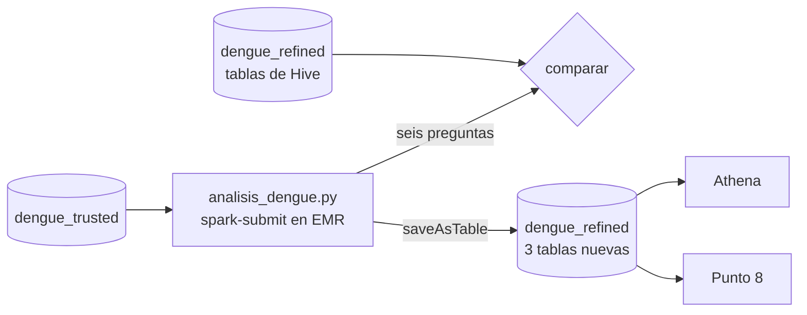

# Punto 7: Análisis descriptivo con PySpark
 
Este punto procesa los datos con la API de DataFrames de Spark en Python, sin escribir SQL. El job [`pyspark/analisis_dengue.py`](pyspark/analisis_dengue.py) corre en el cluster de EMR del [Punto 5](../punto5-catalogacion/README.md), lee `dengue_trusted` desde el catálogo de Glue y hace dos cosas:

1. **Responde otra vez las seis preguntas de negocio** con funciones de PySpark y compara cada respuesta con la tabla que Hive dejó en `dengue_refined` en el [Punto 6](../punto6-consultas-sql/README.md).
2. **Calcula tres tablas descriptivas nuevas** y las escribe en la zona `refined`. El [Punto 8](../punto8-visualizacion/README.md) las usa para el mapa, la serie de tiempo y los indicadores.



## Qué hace el job

| Parte | Funciones de PySpark que usa |
|---|---|
| Lectura de `trusted` | `spark.table` sobre el catálogo de Glue |
| Incidencia, puestos y semana pico | `groupBy`, `agg`, `join`, `Window` con `rank` y `row_number` |
| Brote de 2024 | `pivot` por año y una ventana sin partición para el total |
| Clima con rezago | `lag` sobre una ventana por municipio, `explode` de un arreglo de rezagos y `corr` por municipio |
| Altitud | `when` encadenados para los rangos |
| Estadísticas | `stddev`, `percentile`, suma acumulada con `rowsBetween` |
| Comparación con Hive | `join` completo por la llave y tolerancia del redondeo |
| Escritura | `saveAsTable` en Parquet sobre `s3://dengue-datalake-<cuenta>/refined/` |

## Tablas nuevas en `refined`

| Tabla | Filas | Una fila por | Columnas principales |
|---|---:|---|---|
| `municipio_anual` | 3.364 | Municipio y año | Coordenadas, altitud y su rango, población, casos, dengue grave, muertes, incidencia y su puesto, temperatura media, lluvia y humedad del año |
| `serie_semanal_departamento` | 4.802 | Departamento y semana epidemiológica | Fecha de inicio de la semana, casos, dengue grave y muertes |
| `estadisticas_incidencia` | 3 | Año | Media, desviación, percentiles 25, 50, 75 y 90, máximo y concentración de los casos |

El clima de `municipio_anual` solo existe para los 300 municipios con datos de Open-Meteo. En los demás queda vacío.

## Resultados

### Las seis preguntas

PySpark da las mismas siete tablas que Hive, Athena y Spark SQL en el Punto 6. Por ejemplo, el Valle del Cauca tuvo en 2024 la mayor incidencia, con 1.890,73 casos por 100.000 habitantes, y explica el 35,02 % del aumento de casos frente a 2023. Respuestas completas en el punto 6.

### Distribución de la incidencia municipal

| Año | Municipios con casos | Media | Mediana | Percentil 90 | Máximo | Municipios que suman la mitad de los casos | Casos en el 10 % de municipios con más casos |
|---|---:|---:|---:|---:|---:|---:|---:|
| 2022 | 750 (66,9 %) | 122,6 | 22,8 | 366,1 | 1.591,6 | 23 | 80,7 % |
| 2023 | 825 (73,6 %) | 262,8 | 69,7 | 808,4 | 3.290,6 | 29 | 75,3 % |
| 2024 | 954 (85,0 %) | 603,4 | 277,2 | 1.685,1 | 6.910,0 | 25 | 76,4 % |

- **El dengue está muy concentrado.** Cada año, entre 23 y 29 municipios suman la mitad de los casos del país, y el 10 % de los municipios con más casos reúne tres cuartas partes del total.
- **El brote de 2024 se extendió a más municipios.** Los municipios con al menos un caso pasaron del 66,9 % en 2022 al 85,0 % en 2024. La mediana de la incidencia se multiplicó por 12, mientras que la media solo por 5. Es decir, el aumento no vino solo de los municipios que ya tenían muchos casos.
- **La media está muy por encima de la mediana.** Unos pocos municipios pequeños tienen tasas muy altas, por eso la mediana describe mejor un municipio típico.

### Ciudades medianas y grandes

Entre los municipios de más de 100.000 habitantes, los de mayor incidencia en 2024 fueron Guadalajara de Buga (3.763,5), Yumbo (3.713,9) y Jamundí (3.074,1), del Valle del Cauca, seguidos por Pitalito, Huila (2.601,3), y Cartago, Valle del Cauca (2.495,9). Todos están entre 900 y 1.300 m de altitud y tuvieron temperaturas medias de 19 °C a 23 °C, coherente con la franja de altitud donde más creció el dengue en el Punto 6.

### Serie semanal

La semana con más casos en el país fue la 21 de 2024, que empezó el 19 de mayo, con 9.396 casos. Las cinco semanas con más casos van de mediados de mayo a mediados de junio de 2024.

## Decisiones de diseño

- **API de DataFrames en vez de SQL:** el Punto 6 ya usó Spark SQL. Aquí cada pregunta se escribe con funciones de PySpark, para mostrar la otra forma de usar Spark y para tener una cuarta implementación que confirme las respuestas.
- **Comparación dentro del job:** el job lee las tablas de Hive y las compara columna por columna con sus propias respuestas. Si alguna no coincide, el paso de EMR termina en error.
- **Rezagos con `explode`:** las funciones de ventana no se pueden usar dentro de `explode`. Por eso primero se calcula cada rezago como columna con `lag`, y después se apilan en una fila por rezago para calcular todas las correlaciones con un solo `groupBy`.
- **Tablas nuevas con `saveAsTable`:** como EMR usa Glue como metastore, `saveAsTable` crea la tabla en `dengue_refined` y Athena la puede leer sin otro paso. Las tablas del Punto 6 no se tocan.
- **Percentiles exactos:** se usa `percentile` y no `percentile_approx`, porque solo hay unos 1.100 municipios por año y el cálculo exacto es barato.
- **Modo local:** el mismo job corre fuera de EMR con `--trusted`, `--refined` y `--salida`, leyendo carpetas de Parquet. Así se probó antes de llevarlo al cluster.

## Requisitos

- Punto 6 terminado, con las siete tablas de `refined` llenas.
- Un cluster `dengue-emr` en *Waiting*. Si se apagó al terminar el Punto 6, se crea de nuevo con el script del Punto 5. Tarda unos 5 minutos:

```bash
./punto5-catalogacion/01_crear_emr.sh
```

- Credenciales del lab vigentes en `~/.aws/credentials`.

## Cómo reproducirlo

**1. Correr el job en EMR.** Sube el job, lo corre con `spark-submit` como paso del cluster y muestra su salida. El paso tarda unos 2 minutos, y EMR publica la salida unos 5 minutos después. Debe terminar en `OK: PySpark da las mismas 7 respuestas que Hive y escribió 3 tablas nuevas en refined.`

```bash
./punto7-pyspark/00_analisis_pyspark.sh
```

**2. Verificar con Athena.** Cuenta las filas de las tablas nuevas y las cruza con `trusted` y con las tablas del Punto 6. Debe terminar en `OK: Athena lee las 3 tablas de PySpark y cuadran con trusted y refined.`

```bash
./punto7-pyspark/01_verificar_pyspark.sh
```

**3. Apagar el cluster** si no se va a usar más:

```bash
./punto5-catalogacion/terminar_emr.sh
```

### Correrlo en local, sin EMR

Necesita Java 17 o 21 y `pyspark==3.5.5`. Usa las copias locales que descargó el Punto 6 en `punto4-preparacion/datos/trusted` y `punto6-consultas-sql/datos/refined`:

```bash
spark-submit punto7-pyspark/pyspark/analisis_dengue.py --trusted punto4-preparacion/datos/trusted --refined punto6-consultas-sql/datos/refined --salida punto7-pyspark/datos
```

## Valores esperados

| Revisión | Valor |
|---|---:|
| `municipio_anual` | 3.364 filas |
| `serie_semanal_departamento` | 4.802 filas |
| `estadisticas_incidencia` | 3 filas |
| Casos en la serie semanal, igual a `trusted` | 506.794 |
| Muertes en la serie semanal, igual a `trusted` | 478 |
| Casos de 2024 en `municipio_anual`, igual a `incidencia_departamento` | 312.154 |
| Municipios con clima en 2024 | 300 |

Los casos de `trusted` no incluyen los 1.012 del exterior que se quitaron en el Punto 4. Los de 2024 por municipio no incluyen los que no cruzan con la población del DANE, igual que en el Punto 6.

## Archivos

| Archivo | Qué hace |
|---|---|
| `comun.sh` | Ruta del job y nombres de las tablas |
| `pyspark/analisis_dengue.py` | Job de PySpark: seis preguntas, comparación con Hive y tablas nuevas |
| `00_analisis_pyspark.sh` | Sube el job y lo corre como paso de EMR |
| `01_verificar_pyspark.sh` | Lee las tablas nuevas con Athena y las cruza con las demás |

## Evidencias

- `01a-analisis-pyspark.png`: terminal con la salida de PySpark de `00_analisis_pyspark.sh`, con las seis preguntas.
- `01b-analisis-pyspark.png`: final de la misma salida, con la comparación contra Hive, las estadísticas, las tablas nuevas y el mensaje `OK`.
- `02-paso-emr-consola.png`: consola de EMR, en la pestaña **Steps** de `dengue-emr`, con el paso *Análisis con PySpark* en *Completed*.
- `03-codigo-pyspark.png`: editor con `pyspark/analisis_dengue.py` abierto en la función `p4_clima`.
- `04-glue-refined.png`: consola de Glue, en **Data Catalog > Tables**, filtrada por `dengue_refined`, con las diez tablas.
- `05-verificar-pyspark.png`: terminal con la salida de `01_verificar_pyspark.sh` y el mensaje `OK`.
- `06-athena-municipio-anual.png`: consola de Athena con una consulta sobre `dengue_refined.municipio_anual` y su resultado.
