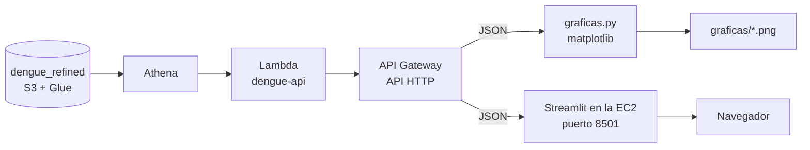
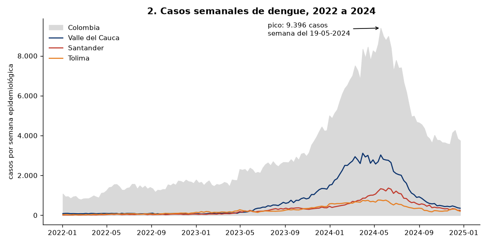
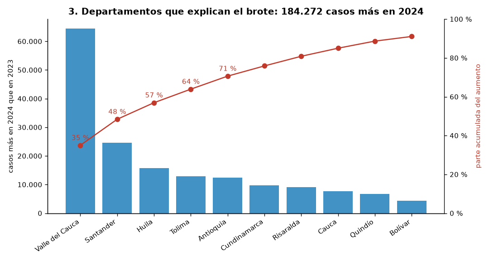
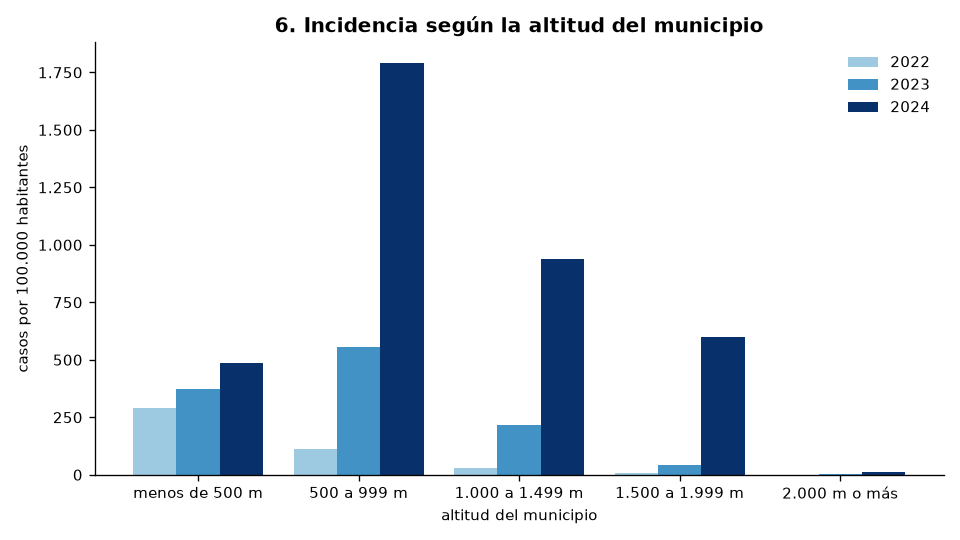

# Punto 8: Visualización, API Gateway y Streamlit
 
Este punto expone las respuestas de la zona `refined` en una API y construye dos aplicaciones que la consumen:

- **API en API Gateway:** una API HTTP que llama una función Lambda. La Lambda consulta `dengue_refined` con Athena y devuelve JSON. Expone las siete tablas del [Punto 6](../punto6-consultas-sql/README.md) y las tres del [Punto 7](../punto7-pyspark/README.md).
- **Gráficas con matplotlib:** [`graficas.py`](graficas.py) pide los datos a la API y dibuja una gráfica por pregunta de negocio en [`graficas/`](graficas/).
- **Tablero en Streamlit:** [`app/app.py`](app/app.py) corre en la EC2 del [Punto 2](../punto2-fuentes-datos/README.md) y lee todos sus datos de la API. Tiene filtros por año y departamento, un mapa de casos y una pestaña por pregunta.



## La API

URL base: `https://<id>.execute-api.us-east-1.amazonaws.com`. `00_crear_api.sh` la muestra al final.

| Ruta | Qué devuelve |
|---|---|
| `GET /` | Lista de tablas, con su descripción y los filtros que aceptan |
| `GET /tablas/{tabla}` | Las filas de la tabla, ordenadas y con los tipos de cada columna |
| `GET /tablas/{tabla}?ano=2024&cod_dpto=76&cod_mpio=76001&limite=10` | Las filas filtradas. Cada tabla acepta solo los filtros que tienen sentido para ella |

Ejemplo de respuesta de `GET /tablas/incidencia_departamento?ano=2024&limite=1`:

```json
{
  "tabla": "incidencia_departamento",
  "descripcion": "Pregunta 1: incidencia por departamento y año",
  "filtros": {"ano": "2024"},
  "filas": 1,
  "columnas": ["ano", "cod_dpto", "departamento", "casos", "poblacion", "incidencia_100k", "puesto"],
  "segundos": 1.12,
  "athena": {"id": "...", "resultado_reusado": false},
  "datos": [{"ano": 2024, "cod_dpto": "76", "departamento": "VALLE DEL CAUCA", "casos": 88740,
             "poblacion": 4693432, "incidencia_100k": 1890.73, "puesto": 1}]
}
```

| Tabla | Filtros |
|---|---|
| `incidencia_departamento`, `estacionalidad_departamento` | `ano`, `cod_dpto` |
| `incidencia_municipio`, `municipio_anual` | `ano`, `cod_dpto`, `cod_mpio` |
| `serie_semanal_departamento` | `ano`, `cod_dpto` |
| `brote_2024_departamento`, `gravedad_departamento` | `cod_dpto` |
| `incidencia_altitud`, `estadisticas_incidencia` | `ano` |
| `clima_rezago` | Ninguno |

Una tabla que no existe responde `404`. Un filtro que la tabla no acepta, o un valor con un formato inválido, responde `400`.

## Gráficas

`02_graficas.sh` las genera en [`graficas/`](graficas/):

| Archivo | Pregunta | Qué muestra |
|---|---|---|
| `p1_incidencia_departamento.png` | 1 | Los diez departamentos con mayor incidencia en 2024, comparados con 2022 y 2023 |
| `p2_serie_semanal.png` | 2 | Casos semanales del país y de los tres departamentos con más casos, con el pico de mayo de 2024 |
| `p3_brote_2024.png` | 3 | Aumento de casos por departamento y la parte acumulada del aumento total |
| `p4_clima_rezago.png` | 4 | Correlación promedio de la temperatura, la lluvia y la humedad con la incidencia, según el rezago |
| `p5_gravedad_letalidad.png` | 5 | Gravedad contra letalidad por departamento, con el tamaño según los casos |
| `p6_incidencia_altitud.png` | 6 | Incidencia por rango de altitud en cada año |
| `p7_distribucion_municipios.png` | Punto 7 | Distribución de la incidencia de los municipios con casos, en escala logarítmica |







## Tablero en Streamlit

| Sección | Contenido |
|---|---|
| Indicadores, arriba de las pestañas | Casos, incidencia, dengue grave, muertes y municipios con casos del año y departamento elegidos, con el cambio frente al año anterior |
| Mapa | Un círculo por municipio con casos, con tamaño según los casos, y los 15 municipios con más casos |
| Serie semanal | Casos por semana epidemiológica de 2022 a 2024 y la semana con más casos |
| Incidencia | Departamentos ordenados por incidencia o, si se elige uno, sus municipios |
| Brote 2024 | Aumento de casos por departamento y la parte que explican los tres primeros |
| Clima | Correlación por rezago, y temperatura contra incidencia de cada municipio |
| Gravedad | Gravedad contra letalidad y la tabla completa |
| Altitud | Incidencia por rango de altitud y año |

Los datos se piden a la API una vez y se guardan una hora en la caché de Streamlit, así que cambiar de filtro no vuelve a consultar Athena.

## Decisiones de diseño

- **API Gateway expone los datos, no la página de Streamlit:** Streamlit mantiene una conexión WebSocket entre el navegador y el servidor. Las API HTTP y REST de API Gateway no reenvían esa conexión cuando hacen de proxy, así que la página cargaría pero se quedaría en *Connecting*. Por eso API Gateway publica la API de datos, y Streamlit y matplotlib son clientes de esa API. Es la misma separación que tendría un sistema real entre el servicio de datos y sus pantallas.
- **Lambda con Athena, sin servidores:** la Lambda no guarda datos. Cada pedido se convierte en un `SELECT` sobre `dengue_refined`, la misma base que leen Hive, Spark y Athena en los puntos anteriores.
- **Reuso de resultados de Athena:** la Lambda activa `ResultReuseConfiguration` por 60 minutos. Si se repite la misma consulta, Athena devuelve el resultado guardado sin leer S3 otra vez. `01_probar_api.sh` lo muestra al pedir dos veces la misma ruta.
- **Filtros validados antes del SQL:** cada filtro tiene un patrón fijo (`ano` de cuatro dígitos, `cod_dpto` de dos y `cod_mpio` de cinco) y la tabla tiene que estar en una lista. Así no se puede inyectar SQL desde la URL.
- **Rol del lab:** la Lambda usa `LabRole`, porque el Learner Lab no deja crear roles de IAM.
- **App en la EC2 del Punto 2:** se reusa la instancia de fuentes. La app corre como servicio de `systemd`, así que vuelve a arrancar sola si la EC2 se reinicia. El puerto 8501 se abre solo para la IP de quien despliega.
- **Versiones fijas:** la app usa Streamlit 1.40.2, que funciona con el Python 3.9 de Amazon Linux 2023. El instalador usa Python 3.11 si está disponible.

## Requisitos

- Puntos 6 y 7 terminados, con las diez tablas en `dengue_refined`. El cluster de EMR ya no se necesita.
- La EC2 `dengue-fuentes` del Punto 2 encendida, y la llave `~/.ssh/labsuser.pem`. Si está apagada:

```bash
./punto2-fuentes-datos/encender_apagar.sh iniciar
```

- El entorno de Python del proyecto con `matplotlib`:

```bash
source .venv/bin/activate
```

```bash
pip install -r requirements.txt
```

## Cómo reproducirlo

**1. Crear la API.** Crea la Lambda `dengue-api` y la API HTTP `dengue-api`, le da permiso a API Gateway para invocar la Lambda y hace una primera consulta. Si se corre de nuevo, actualiza el código de la Lambda. Debe terminar en `OK: la API responde en https://...`

```bash
./punto8-visualizacion/00_crear_api.sh
```

**2. Probar la API.** Pide varias rutas con `curl`, incluidas tres que deben dar error. Debe terminar en `OK: la API responde las 10 tablas de dengue_refined y rechaza las rutas y filtros inválidos.`

```bash
./punto8-visualizacion/01_probar_api.sh
```

**3. Hacer las gráficas.** Pide los datos a la API y guarda siete gráficas en `graficas/`.

```bash
./punto8-visualizacion/02_graficas.sh
```

**4. Desplegar el tablero.** Abre los puertos 22 y 8501 de la EC2 para tu IP, copia la app, instala Streamlit y deja el servicio `dengue-app` corriendo. La primera vez tarda unos 3 minutos. Al final muestra la dirección del tablero, `http://<ip de la EC2>:8501`.

```bash
./punto8-visualizacion/03_desplegar_app.sh
```

La IP pública de la EC2 cambia cada vez que se reinicia. Si cambia, el servicio arranca solo y basta con abrir la nueva IP. Si cambia tu propia IP, vuelve a correr `03_desplegar_app.sh` para abrir los puertos.

### Probar la app en local

También se puede correr en local, apuntando a la misma API:

```bash
pip install -r punto8-visualizacion/app/requirements.txt
```

```bash
API_URL=https://<id>.execute-api.us-east-1.amazonaws.com streamlit run punto8-visualizacion/app/app.py
```

### Apagar o borrar

Para dejar de gastar crédito, apagar la EC2 y la RDS:

```bash
./punto2-fuentes-datos/encender_apagar.sh detener
```

La Lambda y la API solo cobran cuando se usan. Para borrarlas:

```bash
aws apigatewayv2 delete-api --api-id <id>
```

```bash
aws lambda delete-function --function-name dengue-api
```

## Archivos

| Archivo | Qué hace |
|---|---|
| `comun.sh` | Nombres de la Lambda y la API, y funciones para la URL y los puertos |
| `api/lambda_function.py` | Lambda que valida la ruta y los filtros, consulta Athena y devuelve JSON |
| `api/mostrar_respuesta.py` | Muestra una respuesta de la API como tabla en la terminal |
| `00_crear_api.sh` | Crea o actualiza la Lambda y la API HTTP |
| `01_probar_api.sh` | Prueba las rutas de la API con `curl` |
| `graficas.py` | Hace las gráficas de matplotlib con los datos de la API |
| `02_graficas.sh` | Corre `graficas.py` con la URL de la API |
| `app/app.py` | Tablero de Streamlit |
| `app/requirements.txt` | Versiones de Streamlit, pandas y requests para la app |
| `app/instalar_app.sh` | Corre en la EC2: instala la app y crea el servicio `dengue-app` |
| `03_desplegar_app.sh` | Copia la app a la EC2 y la instala |
| `graficas/` | Gráficas generadas |

## Evidencias

- `01-crear-api.png`: terminal con la salida de `00_crear_api.sh`, con la tabla de la API y el mensaje `OK`.
- `02-api-gateway-consola.png`: consola de API Gateway con `dengue-api`, en **Integrations** o **Routes**, donde se vea la integración con la Lambda.
- `03-lambda-consola.png`: consola de Lambda con `dengue-api`, donde se vea API Gateway como disparador.
- `04a-probar-api.png` y `04b-probar-api.png`: terminal con la salida de `01_probar_api.sh`, con las respuestas `200`, `404` y `400` y el mensaje `OK`.
- `05-api-navegador.png`: navegador con `https://<id>.execute-api.us-east-1.amazonaws.com/tablas/incidencia_departamento?ano=2024&limite=5` y el JSON.
- `06-graficas.png`: terminal con la salida de `02_graficas.sh`.
- `07-desplegar-app.png`: terminal con la salida de `03_desplegar_app.sh` y la dirección de la app.
- `08a-app-indicadores-mapa.png`: tablero con los indicadores de 2024 y el mapa.
- `08b-app-serie-semanal.png`: pestaña *Serie semanal*.
- `08c-app-valle.png`: tablero con el departamento Valle del Cauca elegido, en la pestaña *Incidencia*.
- `08d-app-clima.png`: pestaña *Clima*.
